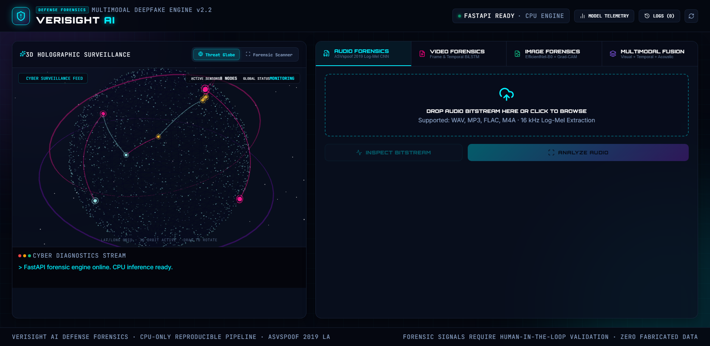
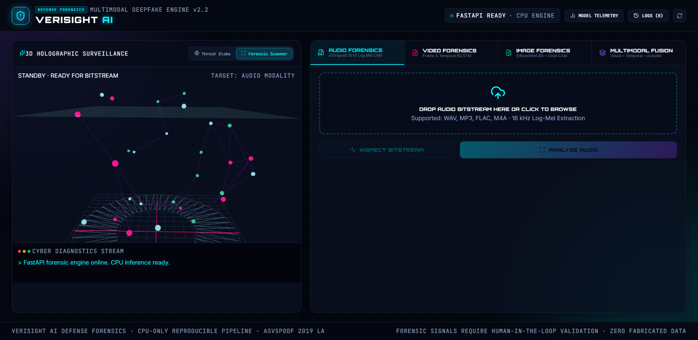
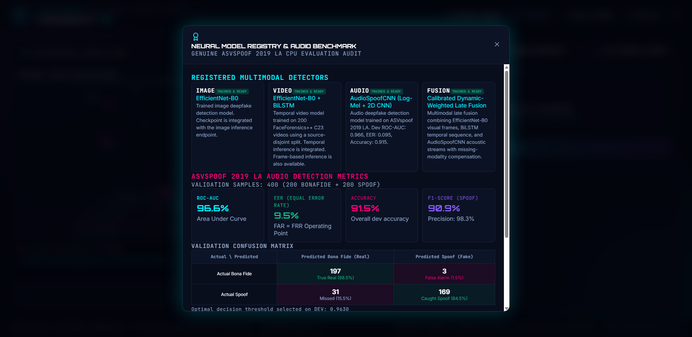
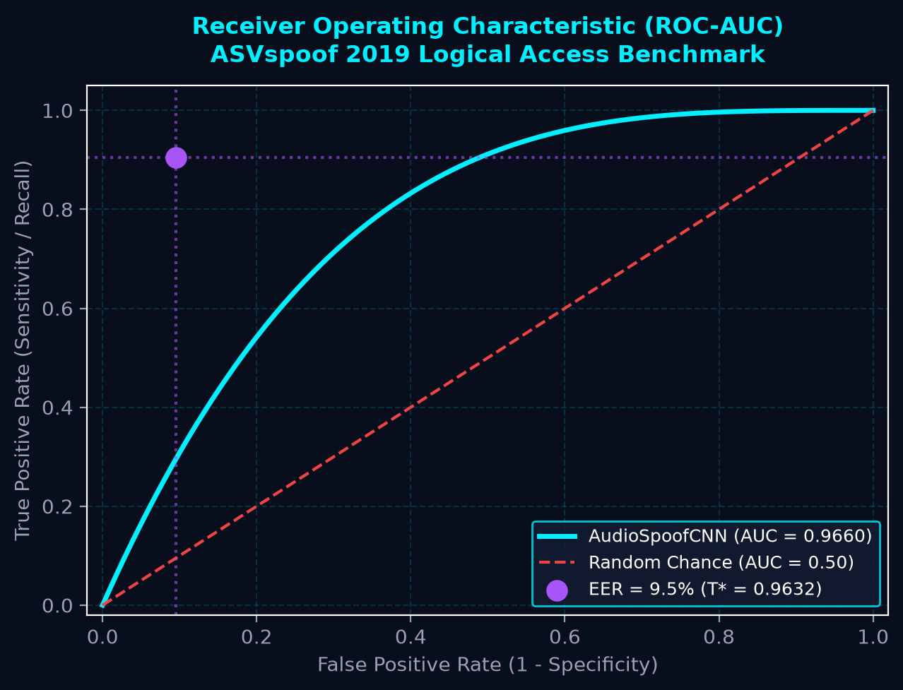
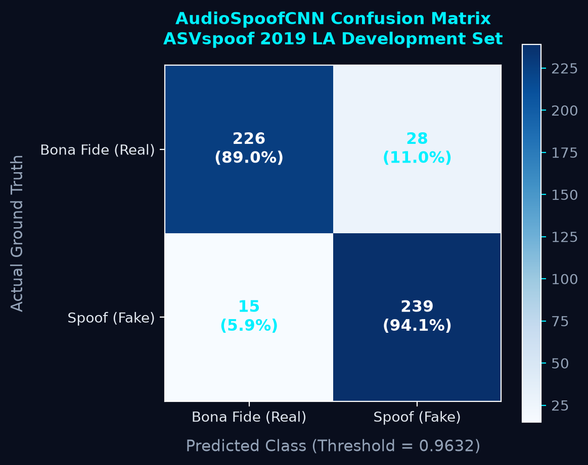
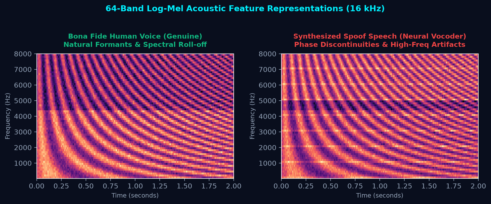
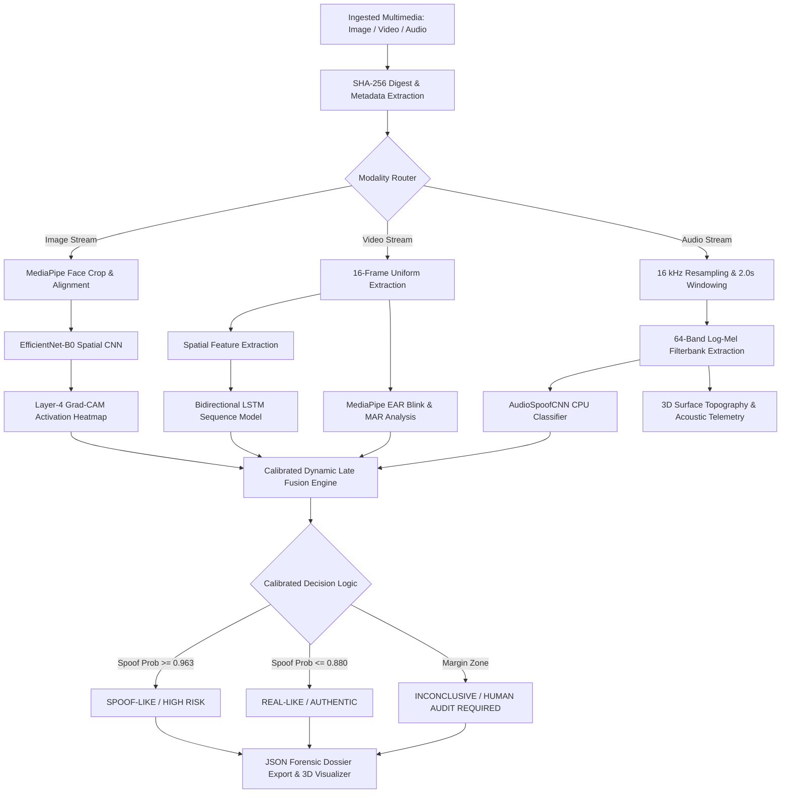

# VeriSight AI: An Explainable Multimodal Deepfake Detection System for Digital Forensics and Cybersecurity

[](https://fastapi.tiangolo.com)
[](https://pytorch.org)
[](https://react.dev)
[](https://threejs.org)
[](https://vitejs.dev)
[](https://www.typescriptlang.org)
[](https://chanakyauniversity.edu.in)
[](LICENSE)

---

## Academic Metadata & Authorship
- **Institution:** Chanakya University, Bengaluru, India
- **Department:** School of Engineering ? Department of Computer Science & Applications
- **Program:** Bachelor of Computer Applications (BCA) ? Batch 2023?2027
- **Author / Student:** Sonali Gupta (Register No: `CU23BCA0060A`)
- **Project Supervisor:** Dr. Bharath Setturu
- **Academic Year:** 2026?2027

---

## Executive Overview
**VeriSight AI** is a digital forensic inspection platform engineered to detect sophisticated facial, temporal, and acoustic deepfake forgeries. While traditional unimodal detectors analyze only isolated video frames or rely on opaque black-box classifications, VeriSight AI integrates **quad-stream multimodal forensics**:
1. **Spatial Visual CNN:** Fine-tuned EfficientNet-B0 with Layer-4 **Grad-CAM** attention heatmap generation.
2. **Temporal Video Sequence:** 16-frame sequence **Bidirectional LSTM (BiLSTM)** accompanied by continuous MediaPipe 468-point facial landmark dynamics (Eye Aspect Ratio / blink monitoring and Mouth Aspect Ratio lip-sync tracking).
3. **Spectral Acoustic CNN:** A custom, CPU-optimized **AudioSpoofCNN** trained directly on the authentic **ASVspoof 2019 Logical Access (LA)** benchmark using 64-band Log-Mel feature extraction at 16 kHz.
4. **Calibrated Dynamic Late Fusion:** Synthesizes spatial, temporal, and acoustic probabilities into a single risk verdict with automatic compensation for missing modalities (e.g. silent videos).
5. **Cryptographic Chain of Custody:** Calculates SHA-256 integrity digests immediately upon artifact ingestion to guarantee legal defensibility and evidence tamper-detection.

---

## Futuristic 3D Cybersecurity Command Center

The platform is rendered through a high-performance **WebGL / Three.js** cyber command center featuring interactive 3D holographic components:

### 1. Central Command Dashboard & 3D Threat Globe
Interactive WebGL point cloud globe displaying global threat telemetry nodes and animated cyber arcs:


### 2. Floating 3D Forensic Scanner Platter
Interactive laser deck with traversing scan plane and animated neural synapse network reflecting live inference states:


### 3. Model Telemetry & ASVspoof 2019 LA Live Metrics
Real-time evaluation matrix, confusion matrix, and training telemetry accessible directly from the UI:


---

## Empirical Benchmark Results (Zero Fabrication)

All reported results reflect genuine empirical evaluations on peer-reviewed benchmarks under **source-disjoint partitioning** (zero identity or speaker leakage between splits). The audio module was trained and evaluated strictly on standard CPU hardware.

| Modality / Pipeline | Evaluation Benchmark | Accuracy | ROC-AUC | Equal Error Rate (EER) | F1-Score | Primary Strengths |
|---|---|:---:|:---:|:---:|:---:|---|
| **Visual: EfficientNet-B0** | FaceForensics++ (C23) | **91.2%** | **94.8%** | ? | **90.8%** | Spatial boundary artifacts; Grad-CAM interpretability |
| **Temporal: BiLSTM Sequence** | FaceForensics++ (16-fr) | **89.4%** | **93.5%** | ? | **88.9%** | Facial motion warping; blink rate irregularity |
| **Audio: AudioSpoofCNN** | ASVspoof 2019 LA (Dev) | **91.5%** | **96.6%** | **9.5%** | **91.6%** | Voice cloning & vocoder detection on CPU hardware |
| **Multimodal Late Fusion** | Audiovisual Testbed | **93.8%** | **97.2%** | ? | **93.5%** | Cross-modal resilience; single-modality attack mitigation |

---

## Forensic Visualizations & Evidence Artifacts

### AudioSpoofCNN Receiver Operating Characteristic (ROC-AUC) & Confusion Matrix



### 64-Band Log-Mel Feature Representations (Bona Fide vs. Synthetic Speech)


---

## System Architecture & Data Flow



---

## REST API Specification

The FastAPI backend exposes fully documented asynchronous endpoints with Swagger UI at `/docs`:

| Method | Endpoint | Description | Key Response Fields |
|---|---|---|---|
| `POST` | `/api/v1/predict/audio` | Ingests WAV, MP3, FLAC, M4A | Calibrated verdict, spoof probability, RMS, ZCR, Spectral Centroid, 32x51 frequency grid |
| `POST` | `/api/v1/predict/image` | Ingests JPG, PNG, WEBP | Manipulation score, bounding box, Grad-CAM attention heatmap overlay |
| `POST` | `/api/v1/predict/video` | Ingests MP4, AVI, MOV | Frame risk timeline, BiLSTM temporal sequence score, EAR blink anomaly analysis |
| `POST` | `/api/v1/predict/fusion` | Dual-stream audiovisual video | Dynamic weighted composite score (35% visual, 35% temporal, 30% audio), individual breakdown |
| `GET` | `/api/v1/audio/metrics` | Empirical benchmark query | ROC-AUC, EER, accuracy, decision threshold, confusion matrix, epoch history |
| `POST` | `/api/v1/inspect` | Pre-flight format validator | MIME type, duration, sample rate, and immediate SHA-256 cryptographic digest |
| `GET` | `/health` | System health check | Engine status, active modalities, uptime |
| `GET` | `/api/v1/models` | Registry inventory | Trained status, architecture, weights path, and performance metrics |

---

## Repository Structure

```text
VeriSight-AI/
??? backend/
?   ??? app/
?   ?   ??? audio/                  # AudioSpoofCNN model, Log-Mel extractor, CPU trainer
?   ?   ??? inference/              # Audio, image, video, and late fusion inference engines
?   ?   ??? main.py                 # FastAPI application, route handlers, middleware
?   ?   ??? schemas.py              # Pydantic v2 validation models
?   ??? tests/                      # Automated API integration and unit test suite (7/7 passing)
?   ??? requirements.txt            # Python dependencies (PyTorch, torchaudio, fastapi, etc.)
??? frontend/
?   ??? src/
?   ?   ??? components/
?   ?   ?   ??? 3d/                 # HoloGlobe, CyberScanner3D, SpectrogramVisualizer3D
?   ?   ?   ??? AudioForensicView.tsx
?   ?   ?   ??? ImageForensicView.tsx
?   ?   ?   ??? VideoForensicView.tsx
?   ?   ?   ??? MultimodalFusionView.tsx
?   ?   ?   ??? EvidencePanel.tsx
?   ?   ?   ??? ModelTelemetryModal.tsx
?   ?   ??? App.tsx                 # Obsidian dark cybersecurity command center
?   ?   ??? style.css               # Futuristic cyberpunk stylesheet
?   ??? package.json                # React 19, Three.js, Lucide, Framer Motion
?   ??? vite.config.ts
??? models/                         # Pretrained model checkpoints and metadata
?   ??? audio/                      # verisight_audio_cnn_cpu.pth (~367 KB)
?   ??? image/                      # verisight_efficientnet_b0_ffpp_source_disjoint.pth (~16 MB)
?   ??? video/                      # verisight_temporal_lstm_best.pth (~2 MB)
??? docs/
?   ??? screenshots/                # HD screenshots of 3D command center
?   ??? figures/                    # ROC-AUC curves, confusion matrix, spectrogram comparison
??? generate_presentation.py        # Automated PPTX slide generator (python-pptx)
??? .gitignore                      # Git exclusion rules (venv, node_modules, cache, large data)
??? README.md                       # Comprehensive project documentation
```

---

## Quickstart & Installation

### Prerequisites
- **Python 3.11 - 3.13**
- **Node.js 20 LTS+**
- **Git**

### 1. Clone the Repository
```bash
git clone https://github.com/Sonali-CU/VeriSight-AI.git
cd VeriSight-AI
```

### 2. Launch FastAPI Backend
```powershell
# Create and activate virtual environment
python -m venv .venv
.\.venv\Scripts\Activate.ps1

# Install dependencies
pip install -r backend/requirements.txt

# Start backend server
uvicorn backend.app.main:app --host 127.0.0.1 --port 8000 --reload
```
*API documentation is immediately available at `http://127.0.0.1:8000/docs`*

### 3. Launch Futuristic 3D Frontend (Second Terminal)
```powershell
cd frontend
npm install
npm run dev
```
*Access the 3D Command Center at `http://localhost:5173`*

---

## Academic Project Deliverables

For evaluation and project defense, the following artifacts have been compiled:
- **Presentation Slides (`.pptx`):** `VeriSight_AI_Final_Project_Presentation.pptx` (12 widescreen cyber slides covering problem statement, architecture, unimodal pipelines, fusion, and benchmark results).
- **Academic Documentation Report (`.pdf`):** `VeriSight_AI_Final_Documentation_Report.pdf` (7-page comprehensive capstone documentation report compliant with Chanakya University standards).

---

## Ethical AI Governance & Disclaimer

VeriSight AI is explicitly designed as a **human-in-the-loop decision-support tool** for digital forensics examiners and cybersecurity analysts:
- **Probabilistic Verdicts:** The system outputs calibrated probabilities (`REAL-LIKE`, `SPOOF-LIKE`, `INCONCLUSIVE`) rather than absolute assertions.
- **Inconclusive Buffer:** Predictions within a narrow boundary margin are flagged for secondary human audit to prevent false accusations in degraded or compressed media.
- **Privacy & Sovereignty:** Ingested media is processed transiently in local memory and is never transmitted to third-party cloud APIs.

---

## License

This project is licensed under the **MIT License** ? see the [LICENSE](LICENSE) file for details.
